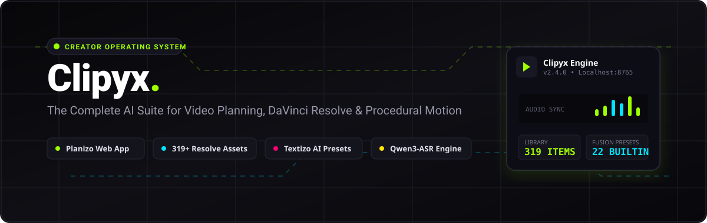
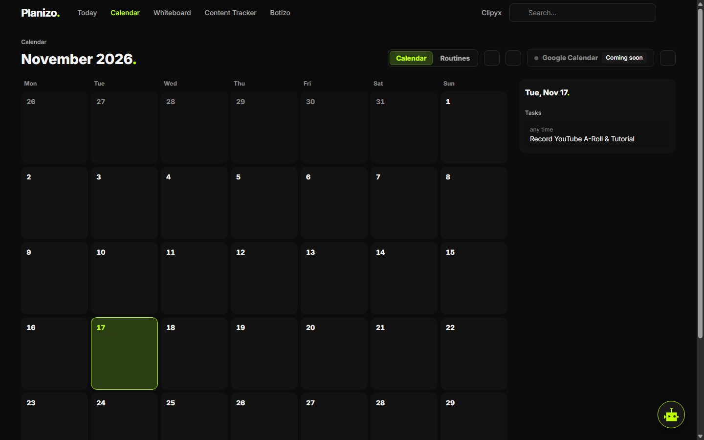
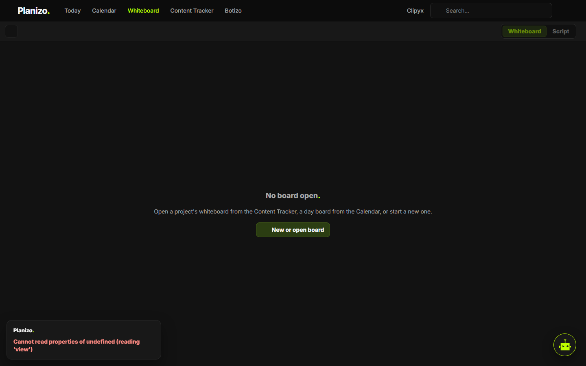

<!-- ===================================================================== -->
<!-- CLIPYX — THE COMPLETE CREATOR AI OPERATING SYSTEM & RESOLVE TOOLKIT   -->
<!-- ===================================================================== -->

<p align="center">
  
</p>

<p align="center">
  <a href="#-senior-engineer-architecture"></a>
  <a href="#-davinci-resolve--fusion-library-319-items"></a>
  <a href="#-textizo-ai-preset-engine"></a>
  <a href="#-transcribe-local-qwen3-asr-toolkit"></a>
  <a href="#-antigravity-ai-skill-integration"></a>
</p>

---

## ⚡ Executive Summary

**Clipyx** is a self-contained, offline-first productivity platform and automated motion-graphics pipeline engineered for video creators, post-production engineers, and autonomous AI agents. 

By unifying **Planizo** (a full-stack local web planning suite), the **Clipyx Library** (319 curated DaVinci Resolve Fusion expressions, motion macros, and node trees), the **Textizo Engine** (a procedural kinetic typography compiler), and **Transcribe** (an offline Qwen3-ASR speech-to-text pipeline), Clipyx bridges the gap between pre-production video planning and timeline rendering in DaVinci Resolve.

---

## 🏛 Senior-Engineer Architecture

The diagram below illustrates the decoupled event bus, local HTTP microservices, state hydration, and timeline injection targets across the Clipyx ecosystem:

<p align="center">
  
</p>

### Subsystem Topology Breakdown

```
┌────────────────────────────────────────────────────────────────────────────────────────┐
│                               CLAYER 1: INGESTION & INTERFACES                         │
│  [Natural Language Prompts] ──► [Antigravity AI Agent] ──► [Unified CLI: clipyx.py]    │
└───────────────────────────────────────────┬────────────────────────────────────────────┘
                                            │
┌───────────────────────────────────────────▼────────────────────────────────────────────┐
│                             LAYER 2: CLIPS CORE SERVICES                               │
│  • Local HTTP Server (Port 8765)           • LocalStorage & Memory Hydration Cache     │
│  • Mock In-Memory REST API Endpoints       • Script B-Roll & Visual Tag Parser         │
└───────┬──────────────────────┬────────────────────────┬───────────────────────┬────────┘
        │                      │                        │                       │
┌───────▼────────┐    ┌────────▼────────┐     ┌─────────▼────────┐     ┌────────▼────────┐
│  SUBSYSTEM A   │    │  SUBSYSTEM B    │     │   SUBSYSTEM C    │     │   SUBSYSTEM D   │
│ Planizo App    │    │ Clipyx Library  │     │ Textizo Presets  │     │ Transcribe ASR  │
│ (React 18 SPA) │    │ (319 Database)  │     │ (AST Compiler)   │     │ (Qwen3 Offline) │
└───────┬────────┘    └────────┬────────┘     └─────────┬────────┘     └────────┬────────┘
        │                      │                        │                       │
┌───────▼──────────────────────▼────────────────────────▼───────────────────────▼────────┐
│                             LAYER 3: DAVINCI RESOLVE STUDIO                            │
│  [Timeline Video Tracks] ◄── [Fusion Node Graph] ◄── [Settings Folder] ◄── [Subtitle] │
└────────────────────────────────────────────────────────────────────────────────────────┘
```

1. **Subsystem A: Planizo Offline Web App (`app/planizo`)**
   - **Runtime:** Client-side React 18 single-page application bundled with Vite.
   - **State Persistence:** Local-first architecture utilizing browser `localStorage` and synchronized mock REST endpoints (`/api/bootstrap`, `/api/range`, `/api/todos`, `/api/whiteboard/file`).
   - **Modularity:** Lazy-loaded dynamic chunks for teleprompter, image manipulation, SVG vector export, and 16 localized international language packs.
2. **Subsystem B: Clipyx Library (`data/clipyx_library.json`)**
   - **Payload:** 319 indexed artifacts classified into expressions (76), motion templates (197), node trees (34), and Lua scripts (9).
   - **Target Vectors:** Injected into Fusion parameters via Inspector expressions, clipboard node pasting (`Ctrl+V`), or DaVinci Resolve Lua workspace consoles.
3. **Subsystem C: Textizo Kinetic Typography Compiler (`tools/textizo`)**
   - **Core Logic:** Abstract Syntax Tree (AST) validation and code generation for Blackmagic Fusion `.setting` format.
   - **Mathematical Curves:** 14-row independent animation channels with parametric eases (`out_cubic`, `out_elastic`, `in_out_sine`) and continuous stagger calculations.
4. **Subsystem D: Transcribe Offline Speech Engine (`tools/transcribe`)**
   - **Model:** Local execution of Alibaba Qwen3-ASR for zero-cloud latency and complete project privacy.
   - **Artifacts:** Millisecond-accurate word timestamps exported as SubRip (`.srt`) and WebVTT (`.vtt`).

---

## 🔄 End-to-End Production Lifecycle

The continuous pipeline transitions raw creative concepts into fully rendered video assets:

<p align="center">
  
</p>

| Stage | Activity | Clipyx Subsystem | CLI Command |
|---|---|---|---|
| **01. Concept & Script** | Scriptwriting with inline `[B-roll: ...]` cues and visual tags | Planizo Whiteboard (Script Mode) | `python clipyx.py plan script <file>` |
| **02. Schedule & Track** | Timeblocking editing blocks and managing YouTube kanban stages | Planizo Calendar & Tracker | `python clipyx.py serve --open` |
| **03. Resolve Motion** | Querying 319 ready-to-paste Fusion expressions & node trees | Clipyx Library Database | `python clipyx.py library search "<query>"` |
| **04. Kinetic Typography** | Generating staggered animated text presets (`.setting`) | Textizo AI Preset Builder | `python clipyx.py preset check <preset>` |
| **05. Voice Alignment** | Local Qwen3-ASR speech-to-text generating subtitles | Transcribe Toolkit | `cd tools/transcribe && ./transcribe.bat` |

---

## 🖥 Visual Walkthrough & App Screenshots

### 1. Planizo Calendar & Multi-Platform Production Schedule
The calendar view provides complete multi-platform release scheduling, creator timeblocking, and routine tracking:

<p align="center">
  
</p>

> **Key Capabilities:**
> - Integrated day/week/month overview with color-coded routine tracking.
> - High-priority task queues tied directly to video publication milestones.
> - Zero internet required: all dates, tasks, and state hydrate seamlessly from local cache.

---

### 2. Planizo Whiteboard & Script B-Roll Breakdown
Planizo's dedicated **Script Mode** isolates spoken script text from on-screen B-roll cues and visual annotations:

<p align="center">
  
</p>

> **Key Capabilities:**
> - Split canvas supporting both node-style visual moodboards and vertical script layouts.
> - B-roll tags with frame ranges automatically highlighted for editors.
> - Integrated teleprompter mode with variable scroll speed controls.

---

### 3. Planizo Daily Operations & Pipeline Tracker
The creator operations center monitors live daily priorities, filming blocks, and video production stages:

<p align="center">
  
</p>

> **Key Capabilities:**
> - Automated task checklist: Hook scripting, Textizo preset compilation, and color grading passes.
> - Quick switcher between Today, Calendar, Whiteboard, and Content Tracker.

---

## 💻 Animated Terminal Interface & Developer CLI

Clipyx includes a unified Python CLI designed for rapid terminal execution and AI agent automation:

<p align="center">
  
</p>

### CLI Command Reference

```powershell
# 1. Planizo Web Server
python clipyx.py serve --port 5173 --open    # Launch local app and open browser
.\clipyx.bat serve --port 5173              # Windows batch launcher

# 2. Clipyx DaVinci Resolve Library (319 Items)
python clipyx.py library search "countdown" # Keyword search across all assets
python clipyx.py library search --category "Titles"    # Filter by category
python clipyx.py library search --type expression      # Filter by type (expression/motion/tree/script)
python clipyx.py library get "count-up"                # Get detailed Inspector paste instructions
python clipyx.py library get "vhs-tape"                # Get full node tree setup steps

# 3. Textizo Animated Text Presets
python clipyx.py preset list                # List all built-in and user presets
python clipyx.py preset next-name           # Calculate next sequential ID (e.g. Textizo-01A)
python clipyx.py preset where               # Print DaVinci Resolve Settings folders
python clipyx.py preset check "tools\textizo\presets\Textizo - Apple Reveal.setting" # Validate preset
python clipyx.py preset install resolve "my-presets\Textizo-01A.setting"             # Deploy to Resolve

# 4. Script & B-Roll Analysis
python clipyx.py plan script "data\sample_script.md"   # Extract shot list and graphics cues
```

---

## 🎨 Textizo Procedural Preset Engine

Textizo generates native Fusion text animator `.setting` files that adhere to the official **Textizo AI Guide** specification.

### Mathematical Animation Formula

$$\text{EndFrame} = \text{StartFrame} + S + D \times (N - 1)$$

$$\text{Stagger}\% = 100 \times \frac{D}{S}$$

- $S$: Frames each letter/word/line moves.
- $D$: Frames of delay between neighboring pieces.
- $N$: Total number of text pieces.

### Architectural Rules Enforced by Validator:
1. **One Node Structure:** Output must be a solitary `Textizo1 = Fuse.Textizo { ... }` node inside `{ Tools = ordered() { ... } }`.
2. **Resolution Preservation:** Must include `UseFrameFormatSettings = 1`, `Width = 1920`, `Height = 1080` to prevent default 320x240 fallback rendering.
3. **Dual Shading Proxy:** Layer 1 is written twice (`ShadingProxy...` and `ShadingElement1...`) with identical attributes to ensure Inspector proxy reflection.
4. **Exit Value Invariance:** `Out` rows omit `...StartValue` (the exit seamlessly inherits wherever the entrance or hold state rests).

---

## 🤖 Antigravity AI Skill Integration

Clipyx is registered as an active Antigravity skill:

- **Global Machine Root:** [`C:\Users\aryan\.gemini\config\skills\clipyx\SKILL.md`](file:///C:/Users/aryan/.gemini/config/skills/clipyx/SKILL.md)
- **Workspace Project Root:** [`Clipyx\.agent\skills\clipyx\SKILL.md`](file:///c:/Users/aryan/Downloads/Clipyx/.agent/skills/clipyx/SKILL.md)
- **Reference Documentation:** [`Clipyx\Textizo AI Guide.md`](file:///c:/Users/aryan/Downloads/Clipyx/Textizo%20AI%20Guide.md)

### Agent Prompt Examples
You can prompt your Antigravity agent naturally:
- *"Plan my next video script for a DaVinci Resolve tutorial, extract all B-roll tags, and launch Planizo."*
- *"Search the Clipyx library for a clean count-up timer expression and give me the exact Fusion inspector paste target."*
- *"Generate a Textizo preset named Textizo-01A with an Apple Reveal style blur-in and slight settle for a 5-second 24 fps clip."*
- *"Transcribe my audio file recording.mp4 and generate an .srt subtitle file on Subtitle Track 1."*

---

## 📂 Repository Layout

```
Clipyx/
├── app/
│   └── planizo/                  # Offline Planizo SPA (Vite/React, CSS, JS chunks, fonts, icons)
├── assets/
│   ├── animations/               # Senior-engineer animated SVGs (Hero, Architecture, Pipeline, Terminal)
│   └── screenshots/              # Real application screenshots (Calendar, Whiteboard, Schedule)
├── data/
│   ├── clipyx_library.json       # 319 Curated DaVinci Resolve expressions & node trees
│   └── sample_script.md          # Sample script formatted with B-roll & graphics cues
├── my-presets/                   # User-authored Textizo .setting presets
├── scripts/
│   ├── clipyx_cli.py             # Core unified CLI implementation
│   └── serve_planizo.py          # Local server with mock REST API & state hydration
├── tools/
│   ├── textizo/                  # Textizo AI Kit (presets, specs, validator)
│   └── transcribe/               # Transcribe Qwen3-ASR offline speech pipeline
├── .agent/
│   └── skills/
│       └── clipyx/
│           └── SKILL.md          # Workspace Antigravity skill definition
├── clipyx.py                     # Primary Python launcher
├── clipyx.bat                    # Windows PowerShell/CMD launcher
├── AGENTS.md                     # Agent instruction file
├── SKILL.md                      # Root skill guide
├── Textizo AI Guide.md           # Complete official Textizo prompt guide
└── README.md                     # Animated senior-level documentation
```

---

<p align="center">
  <b>Clipyx</b> • Built for creators and AI agents • Fully Offline • Zero Cloud Dependencies
</p>
