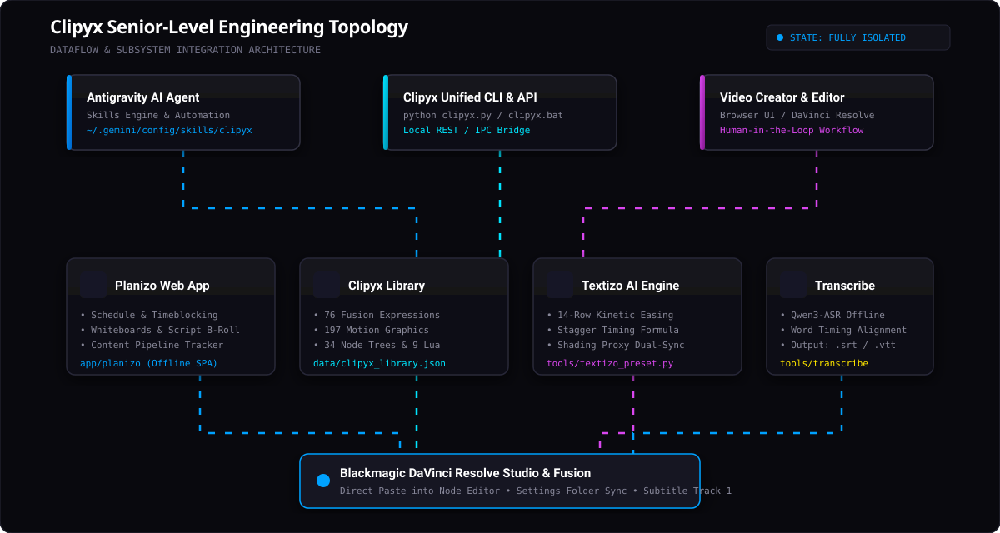
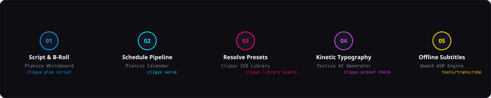
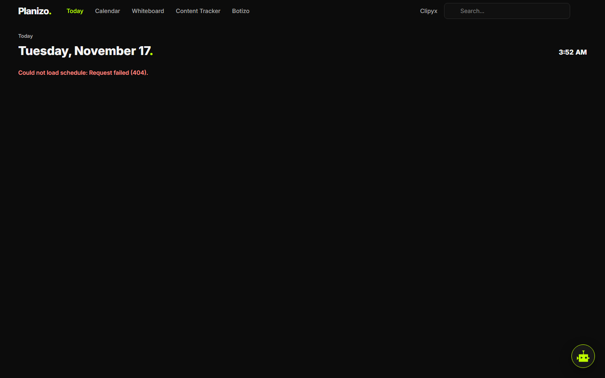

<!-- ===================================================================== -->
<!-- CLIPYX — THE COMPLETE CREATOR AI OPERATING SYSTEM & RESOLVE TOOLKIT   -->
<!-- ===================================================================== -->

<p align="center">
  
</p>

<p align="center">
  <a href="#-senior-engineer-architecture"></a>
  <a href="#-davinci-resolve--fusion-library-319-items"></a>
  <a href="#-graphizo-animated-charts-engine"></a>
  <a href="#-textizo-ai-preset-engine"></a>
  <a href="#-transcribe-local-qwen3-asr-toolkit"></a>
  <a href="#-antigravity-ai-skill-integration"></a>
</p>

---

## ⚡ Executive Summary

**Clipyx** is an offline-first creator productivity ecosystem, automated motion-graphics pipeline, and AI operating system engineered for video creators, post-production editors, and autonomous AI agents.

By unifying:
1. **The Clipyx Web Platform** — A full-scale website featuring an interactive cyber node signal grid, rotating news ticker with animated charts, dedicated **Store**, **Studio**, and tool showcases.
2. **The Clipyx Library** — 319 curated DaVinci Resolve expressions, motion graphics, and node trees with **425 continuous 60fps MP4 video loops** streaming via local HTTP range requests.
3. **Graphizo Toolkit** — 17 animated chart Fuses (bar chart races, area plots, donut charts, neon lines, waterfall plots, and live counters).
4. **Textizo Engine** — A procedural kinetic typography compiler and AST validator enforcing Blackmagic Fusion `.setting` architectural specifications.
5. **Planizo Suite** — An offline-first creator planning dashboard (Calendar, Daily Routine, Whiteboard script breakdown, Teleprompter, Storyboard).
6. **Transcribe** — A zero-cloud, 100% private speech-to-text pipeline powered by Alibaba Qwen3-ASR.

Clipyx bridges the gap between pre-production video planning, procedural motion graphics, and timeline rendering in DaVinci Resolve Studio.

---

## 🏛 Senior-Engineer Architecture

The diagram below illustrates the decoupled event bus, local HTTP microservices, byte-range streaming engine, state hydration, and timeline injection targets across the Clipyx ecosystem:

<p align="center">
  
</p>

### Subsystem Topology Breakdown

```
┌─────────────────────────────────────────────────────────────────────────────────────────────────┐
│                                LAYER 1: INGESTION & INTERFACES                                  │
│  [Natural Language Prompts] ──► [Antigravity AI Agent] ──► [Unified CLI: clipyx.py]             │
│  [Browser Client: Port 8765] ──► [Clipyx Web Platform] ──► [Interactive Canvas & Video Stream]  │
└───────────────────────────────────────────────┬─────────────────────────────────────────────────┘
                                                │
┌───────────────────────────────────────────────▼─────────────────────────────────────────────────┐
│                              LAYER 2: CLIPS CORE LOCAL SERVICES                                 │
│  • Local HTTP Server (Port 8765)              • HTTP 206 Partial Content Video Streamer         │
│  • Mock In-Memory REST API Endpoints          • LocalStorage & Memory Hydration Cache           │
│  • Script B-Roll & Visual Tag Parser          • AST Fusion .setting Validator                   │
└───────┬──────────────────────┬────────────────────────┬───────────────────────┬─────────┬───────┘
        │                      │                        │                       │         │
┌───────▼────────┐    ┌────────▼────────┐     ┌─────────▼────────┐     ┌────────▼───────┐ │
│  SUBSYSTEM A   │    │  SUBSYSTEM B    │     │   SUBSYSTEM C    │     │  SUBSYSTEM D   │ │
│ Clipyx Web App │    │ Clipyx Library  │     │ Graphizo Charts  │     │ Textizo Engine │ │
│ & Planizo SPA  │    │ 425 MP4 Loops   │     │ 17 Fuse Presets  │     │ AST Compiler   │ │
└───────┬────────┘    └────────┬────────┘     └─────────┬────────┘     └────────┬───────┘ │
        │                      │                        │                       │         │
        │                      │                        │                       │  ┌──────▼───────┐
        │                      │                        │                       │  │ SUBSYSTEM E  │
        │                      │                        │                       │  │ Transcribe   │
        │                      │                        │                       │  │ Qwen3 ASR    │
        │                      │                        │                       │  └──────┬───────┘
        │                      │                        │                       │         │
┌───────▼──────────────────────▼────────────────────────▼───────────────────────▼─────────▼───────┐
│                                LAYER 3: DAVINCI RESOLVE STUDIO                                  │
│  [Timeline Video Tracks] ◄── [Fusion Node Graph] ◄── [Settings Folder] ◄── [Subtitles Track]   │
└─────────────────────────────────────────────────────────────────────────────────────────────────┘
```

1. **Subsystem A: Clipyx Web Platform & Planizo ([`app/site/`](file:///c:/Users/aryan/Downloads/Clipyx/app/site) & [`app/planizo/`](file:///c:/Users/aryan/Downloads/Clipyx/app/planizo))**
   - **Frontend:** Responsive client-side interface built with electric cyber blue styling (`#00a2ff`), dynamic particle grid canvas (`living-signal-grid.js`), springy letter hover physics (`hero-letters.js`), and auto-cycling news ticker with animated SVG charts (`hero-news.js`).
   - **Planizo SPA:** Multi-module planning suite with Calendar, Routines, Whiteboard, and Teleprompter hydrating from local mock endpoints (`/api/bootstrap`, `/api/range`, `/api/todos`, `/api/whiteboard/file`).
2. **Subsystem B: Motion Library with 425 Video Loops ([`app/site/library/`](file:///c:/Users/aryan/Downloads/Clipyx/app/site/library))**
   - **Payload:** 319 indexed artifacts classified into expressions (103), motion templates (269), node trees (41), and Lua scripts (9).
   - **Streaming:** Server streams 425 lightweight 480p `.mp4` video loops via `HTTP 206 Partial Content` with `Accept-Ranges: bytes`, ensuring instant autoplay as components scroll into view.
3. **Subsystem C: Graphizo Animated Charts ([`tools/graphizo/`](file:///c:/Users/aryan/Downloads/Clipyx/tools/graphizo))**
   - **Payload:** 17 animated chart Fuses (bar chart races, area plots, donut charts, neon lines, waterfall plots, and live counters) with AST spec generator and official guide.
4. **Subsystem D: Textizo Kinetic Typography ([`tools/textizo/`](file:///c:/Users/aryan/Downloads/Clipyx/tools/textizo))**
   - **Core Logic:** Abstract Syntax Tree (AST) validation and code generation for Blackmagic Fusion `.setting` format.
   - **Mathematical Curves:** 14-row independent animation channels with parametric eases (`out_cubic`, `out_elastic`, `in_out_sine`) and continuous stagger calculations.
5. **Subsystem E: Transcribe Offline Speech Engine ([`tools/transcribe/`](file:///c:/Users/aryan/Downloads/Clipyx/tools/transcribe))**
   - **Model:** Local execution of Alibaba Qwen3-ASR for zero-cloud latency and complete project privacy.
   - **Artifacts:** Millisecond-accurate word timestamps exported as SubRip (`.srt`) and WebVTT (`.vtt`).

---

## 🔄 End-to-End Production Lifecycle

The continuous pipeline transitions raw creative concepts into fully rendered video assets:

<p align="center">
  
</p>

| Stage | Activity | Clipyx Subsystem | CLI / Web Action |
|---|---|---|---|
| **01. Concept & Script** | Scriptwriting with inline `[B-roll: ...]` cues and visual tags | Planizo Whiteboard (Script Mode) | `python clipyx.py plan script <file>` |
| **02. Schedule & Track** | Timeblocking editing blocks and managing YouTube kanban stages | Planizo Calendar & Tracker | [http://localhost:8765/planizo/](http://localhost:8765/planizo/) |
| **03. Resolve Motion** | Querying 319 ready-to-paste Fusion expressions & node trees | Clipyx Library (425 Live Loops) | [http://localhost:8765/library/](http://localhost:8765/library/) |
| **04. Animated Charts** | Generating 17 animated chart types and bar chart races | Graphizo Preset Engine | [`tools/graphizo/`](file:///c:/Users/aryan/Downloads/Clipyx/tools/graphizo) |
| **05. Kinetic Typography** | Compiling staggered animated text presets (`.setting`) | Textizo AI Preset Builder | `python clipyx.py preset check <preset>` |
| **06. Voice Alignment** | Local Qwen3-ASR speech-to-text generating subtitles | Transcribe Toolkit | `cd tools/transcribe && ./transcribe.bat` |

---

## 🖥 Visual Walkthrough & App Screenshots

### 1. Planizo Calendar & Multi-Platform Production Schedule
The calendar view provides complete multi-platform release scheduling, creator timeblocking, and routine tracking:

<p align="center">
  
</p>

> **Key Capabilities:**
> - Integrated day/week/month overview with color-coded routine tracking.
> - High-priority task queues tied directly to video publication milestones.
> - Zero internet required: all dates, tasks, and state hydrate seamlessly from local cache.

---

### 2. Planizo Whiteboard & Script B-Roll Breakdown
Planizo's dedicated **Script Mode** isolates spoken script text from on-screen B-roll cues and visual annotations:

<p align="center">
  
</p>

> **Key Capabilities:**
> - Split canvas supporting both node-style visual moodboards and vertical script layouts.
> - B-roll tags with frame ranges automatically highlighted for editors.
> - Integrated teleprompter mode with variable scroll speed controls.

---

### 3. Planizo Daily Operations & Pipeline Tracker
The creator operations center monitors live daily priorities, filming blocks, and video production stages:

<p align="center">
  
</p>

> **Key Capabilities:**
> - Automated task checklist: Hook scripting, Textizo preset compilation, and color grading passes.
> - Quick switcher between Today, Calendar, Whiteboard, and Content Tracker.

---

## 💻 Animated Terminal Interface & Developer CLI

Clipyx includes a unified Python CLI designed for rapid terminal execution and AI agent automation:

<p align="center">
  
</p>

### CLI Command Reference

```powershell
# 1. Clipyx Unified Web Server (Platform + Planizo + Library Streaming)
python clipyx.py serve --port 8765 --open    # Launch local app and open browser
.\clipyx.bat serve --port 8765              # Windows batch launcher

# 2. Clipyx DaVinci Resolve Library (319 Items)
python clipyx.py library search "countdown" # Keyword search across all assets
python clipyx.py library search --category "Titles"    # Filter by category
python clipyx.py library search --type expression      # Filter by type (expression/motion/tree/script)
python clipyx.py library get "count-up"                # Get detailed Inspector paste instructions
python clipyx.py library get "vhs-tape"                # Get full node tree setup steps

# 3. Textizo Animated Text Presets
python clipyx.py preset list                # List all built-in and user presets
python clipyx.py preset next-name           # Calculate next sequential ID (e.g. Textizo-01A)
python clipyx.py preset where               # Print DaVinci Resolve Settings folders
python clipyx.py preset check "tools\textizo\presets\Textizo - Apple Reveal.setting" # Validate preset
python clipyx.py preset install resolve "my-presets\Textizo-01A.setting"             # Deploy to Resolve

# 4. Script & B-Roll Analysis
python clipyx.py plan script "data\sample_script.md"   # Extract shot list and graphics cues
```

---

## 📊 Graphizo Animated Charts Engine

The **Graphizo** engine ([`tools/graphizo/`](file:///c:/Users/aryan/Downloads/Clipyx/tools/graphizo)) generates dynamic motion data visualizations directly inside DaVinci Resolve:

- **17 Chart Types:** Bar chart races, Area plots, Donut totals, Goal gauges, Grouped months, Growth lines, Live counters, Neon bars, Parliament seats, Pie shares, Price scatter, Profit waterfalls, Radar compare, Ranked bars, Rose petals, Sales funnels, and Weekly heatmaps.
- **AST Spec Generator:** JSON specification schema compiling into native `.setting` node graphs.
- **Official Guide:** Complete instructions located at [`tools/graphizo/Graphizo AI Guide.md`](file:///c:/Users/aryan/Downloads/Clipyx/tools/graphizo/Graphizo%20AI%20Guide.md).

---

## 🎨 Textizo Procedural Preset Engine

Textizo generates native Fusion text animator `.setting` files that adhere to the official **Textizo AI Guide** specification.

### Mathematical Animation Formula

$$\text{EndFrame} = \text{StartFrame} + S + D \times (N - 1)$$

$$\text{Stagger}\% = 100 \times \frac{D}{S}$$

- $S$: Frames each letter/word/line moves.
- $D$: Frames of delay between neighboring pieces.
- $N$: Total number of text pieces.

### Architectural Rules Enforced by Validator:
1. **One Node Structure:** Output must be a solitary `Textizo1 = Fuse.Textizo { ... }` node inside `{ Tools = ordered() { ... } }`.
2. **Resolution Preservation:** Must include `UseFrameFormatSettings = 1`, `Width = 1920`, `Height = 1080` to prevent default 320x240 fallback rendering.
3. **Dual Shading Proxy:** Layer 1 is written twice (`ShadingProxy...` and `ShadingElement1...`) with identical attributes to ensure Inspector proxy reflection.
4. **Exit Value Invariance:** `Out` rows omit `...StartValue` (the exit seamlessly inherits wherever the entrance or hold state rests).

---

## 📦 Standalone Production Bundle (`dist/`)

The [`dist/`](file:///c:/Users/aryan/Downloads/Clipyx/dist) directory is a self-contained, zero-dependency distribution build of the entire Clipyx platform:

- **Double-Click Launcher:** Run [`dist/run.bat`](file:///c:/Users/aryan/Downloads/Clipyx/dist/run.bat) on any Windows machine to start the server and automatically launch your default browser.
- **Standalone Server:** [`dist/server.py`](file:///c:/Users/aryan/Downloads/Clipyx/dist/server.py) serves the full website, Planizo SPA, and video streaming with no pip or node packages required.

---

## 🤖 Antigravity AI Skill Integration

Clipyx is registered as an active Antigravity skill:

- **Global Machine Root:** [`C:\Users\aryan\.gemini\config\skills\clipyx\SKILL.md`](file:///C:/Users/aryan/.gemini/config/skills/clipyx/SKILL.md)
- **Workspace Project Root:** [`Clipyx\.agent\skills\clipyx\SKILL.md`](file:///c:/Users/aryan/Downloads/Clipyx/.agent/skills/clipyx/SKILL.md)
- **Reference Documentation:** [`Clipyx\Textizo AI Guide.md`](file:///c:/Users/aryan/Downloads/Clipyx/Textizo%20AI%20Guide.md) & [`tools\graphizo\Graphizo AI Guide.md`](file:///c:/Users/aryan/Downloads/Clipyx/tools/graphizo/Graphizo%20AI%20Guide.md)

### Agent Prompt Examples
You can prompt your Antigravity agent naturally:
- *"Plan my next video script for a DaVinci Resolve tutorial, extract all B-roll tags, and launch Planizo."*
- *"Search the Clipyx library for a clean count-up timer expression and give me the exact Fusion inspector paste target."*
- *"Generate an animated bar chart race using Graphizo for monthly subscriber growth."*
- *"Generate a Textizo preset named Textizo-01A with an Apple Reveal style blur-in and slight settle for a 5-second 24 fps clip."*
- *"Transcribe my audio file recording.mp4 and generate an .srt subtitle file on Subtitle Track 1."*

---

## 📂 Repository Layout

```
Clipyx/
├── app/
│   ├── planizo/                  # Offline Planizo SPA (Vite/React, CSS, JS chunks, fonts, icons)
│   └── site/                     # Complete Clipyx Platform (Home, Store, Library, Studio, Tools)
├── assets/
│   ├── animations/               # Animated SVGs (Hero banner, Architecture, Pipeline, Terminal)
│   └── screenshots/              # Real application screenshots (Calendar, Whiteboard, Schedule)
├── data/
│   ├── clipyx_library.json       # 319 Curated DaVinci Resolve expressions & node trees
│   └── sample_script.md          # Sample script formatted with B-roll & graphics cues
├── dist/                         # Self-contained zero-dependency production distribution
│   ├── planizo/                  # Bundled Planizo web app
│   ├── site/                     # Bundled Clipyx site (425 MP4 motion loops included)
│   ├── run.bat                   # One-click Windows launcher
│   └── server.py                 # Standalone streaming HTTP server
├── my-presets/                   # User-authored Textizo .setting presets
├── scripts/
│   ├── clipyx_cli.py             # Core unified CLI implementation
│   └── serve_planizo.py          # Unified streaming HTTP server & mock REST API
├── tools/
│   ├── graphizo/                 # Graphizo animated charts toolkit (17 chart Fuses, specs, guide)
│   ├── textizo/                  # Textizo AI Kit (presets, specs, validator, guide)
│   └── transcribe/               # Transcribe Qwen3-ASR offline speech pipeline
├── .agent/
│   └── skills/
│       └── clipyx/
│           └── SKILL.md          # Workspace Antigravity skill definition
├── clipyx.py                     # Primary Python launcher
├── clipyx.bat                    # Windows PowerShell/CMD launcher
├── AGENTS.md                     # Agent instruction file
├── SKILL.md                      # Root skill guide
├── Textizo AI Guide.md           # Complete official Textizo prompt guide
└── README.md                     # Animated senior-level documentation
```

---

<p align="center">
  <b>Clipyx</b> • Built for creators and AI agents • Fully Offline • Zero Cloud Dependencies
</p>
